<a href="https://github.com/LorenaPensatori">
  <picture>
    <source media="(prefers-color-scheme: dark)" srcset="assets/banner-dark.v9.svg">
    <source media="(prefers-color-scheme: light)" srcset="assets/banner-light.v9.svg">
    
  </picture>
</a>

 

 

---

## `$ whoami`

Hi! I'm **Lorena Pensatori**, an IT graduate from Uruguay with a strong interest in software quality, testing, and development.

I enjoy understanding how systems work, identifying problems, and finding ways to improve them. I have academic project experience working with Java, JavaScript, PHP, SQL, MySQL, Linux, and Git, including backend development, database management, documentation, and validation.

I'm curious, detail-oriented, and always eager to learn new technologies. Currently, I'm focused on growing as a **Junior QA Analyst** while continuing to strengthen my software development skills.

- 🎓 Information Technology Graduate — Escuela Superior de Informática (UTU), Uruguay.
- 🧪 Manual, functional and black/white-box testing.
- 💻 Java, JavaScript, PHP and SQL.
- 🗄️ MySQL, MariaDB and relational databases.
- 🐧 Linux, Bash and Git/GitHub.
- 📍 Montevideo, Uruguay.

### Experience

**DataByte / SiGeRU — Academic Software Project (2026)**

Collaborative project developed at Escuela Superior de Informática (UTU), Uruguay.

- Participated in the development of a web-based urban waste management system.
- Worked with PHP, MySQL/MariaDB, backend APIs and database management.
- Contributed to software documentation, validation and testing.
- Coordinated team activities and project organization.

### Education

**Escuela Superior de Informática (UTU), Uruguay** — Information Technology Graduate, 2026.

### Contact

- [GitHub](https://github.com/LorenaPensatori)
- [LinkedIn](https://www.linkedin.com/in/lorena-pensatori-882a55400/)
- [Email](mailto:lorena.pensatori.it@gmail.com)

---

## `$ cat tech-stack.yaml`

<table border="1" cellpadding="14" bgcolor="#17171c">
  <thead>
    <tr>
      <th colspan="2" align="left"><code>lorena-pensatori:~$ cat tech-stack.yaml</code></th>
    </tr>
  </thead>
  <tbody>
    <tr>
      <td width="50%" valign="top">
        <code>├─ 🧪 testing_and_qa:</code>  
        <code>Manual Testing · Functional Testing · Black-box Testing · White-box Testing · Test Case Design · Equivalence Partitioning · Boundary Value Analysis · Bug Reporting · Software Validation · API Testing</code>
      </td>
      <td width="50%" valign="top">
        <code>├─ ⌘ programming_languages:</code>  
         
        <code>Java · JavaScript · PHP · HTML5 · CSS3 · Bash</code>
      </td>
    </tr>
    <tr>
      <td valign="top">
        <code>├─ ▣ databases:</code>  
         
        <code>SQL · MySQL · MariaDB · Relational Databases</code>
      </td>
      <td valign="top">
        <code>├─ ⚙ tools_and_environment:</code>  
         
        <code>Linux · Bash · Git · GitHub · VS Code · Postman · REST APIs · MVC</code>
      </td>
    </tr>
  </tbody>
</table>

